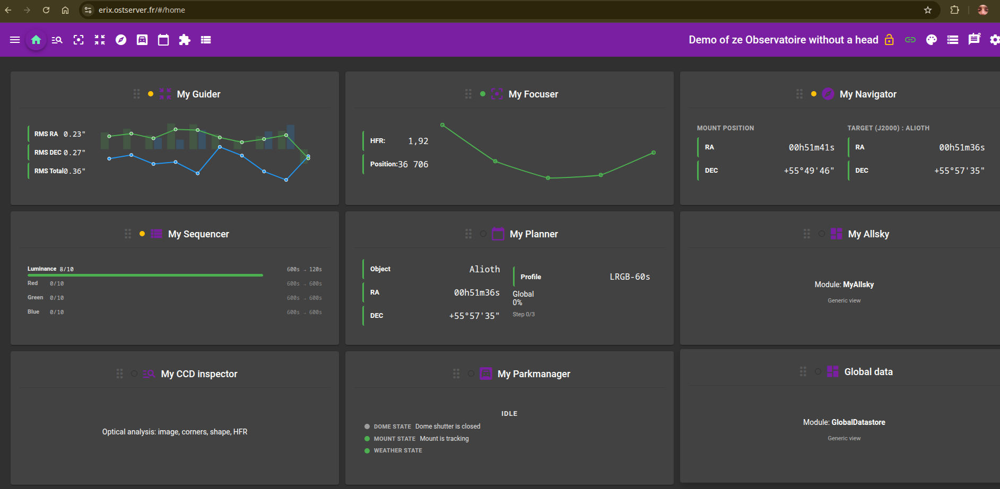

OST es un pequeño servidor de gestión y control remoto de una sesión de astrofotografía.

Su diseño modular permite elegir y personalizar las funciones que se desean controlar.

OST es y seguirá siendo un proyecto OpenSource, utilizando otros componentes basados en un uso libre.

